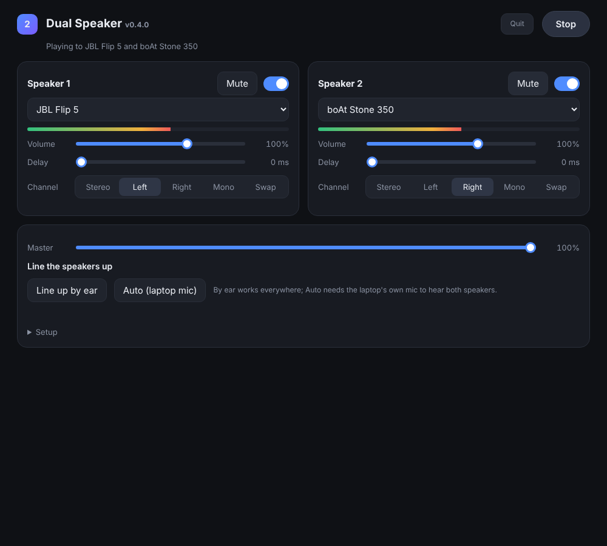
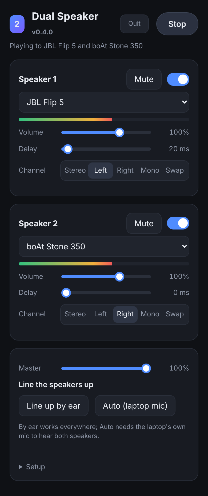

# DUAL-BT-AUDIO: Dual Speaker Mixer

Play your PC's audio on **two speakers at once, even from different brands** (Bluetooth, USB, 3.5 mm or HDMI, in any mix). Each speaker has its own controls, and there's a remote you can open on your phone.

It works like Samsung's **Dual Audio**, but on a Windows PC, and adds the thing Dual Audio users keep asking for: **a delay control for each speaker, plus automatic calibration**.



## Download
Get **`DualSpeaker.exe`** from the [Releases page](../../releases/latest). It's a single file, with no Python or installer needed. Windows may warn you the first time because the app isn't signed: click **More info → Run anyway**.

## Features
- **Two speakers at once:** your PC's audio plays on both.
- **Controls for each speaker:** on/off, mute, volume (0–150%), channel (Stereo, Left only, Right only, Mono, Swap L/R) and delay (0–1000 ms).
- **Stereo pair:** set one speaker to Left and the other to Right.
- **Line up by ear:** both speakers tick together. Move one slider until you hear a single tick. No mic needed.
- **Auto (laptop mic):** each speaker plays short chirps, the laptop's own mic listens, and the app sets the delay. Bluetooth headset mics are never used, because opening one switches that speaker into low-quality call mode.
- **Drift correction:** two speakers keep slightly different time, so the app makes tiny speed adjustments (at most 0.2%, inaudible). They stay in sync for hours with no clicks.
- **Reconnects by itself** if a Bluetooth speaker drops out or is switched off.
- **Simple UI:** the app opens as its own window on the PC, and the same page works on your phone over Wi-Fi at `http://<PC address>:8765`. No app install needed.
- **Live level meters** for each speaker, so you can see that sound is flowing.
- **Settings are saved** to `dual_speaker_settings.json` next to the app.
- **Light on the PC:** under 1% of one CPU core.

## One-time setup
1. Install **VB-CABLE**, a free virtual audio cable, from vb-audio.com/Cable. Restart the PC afterwards.
2. Pair and connect both speakers in Windows. Check that each one plays sound on its own.
3. In Windows Sound settings, set **Output** to **CABLE Input (VB-Audio Virtual Cable)**. All PC audio now flows into the cable, and the app sends it on to your speakers.

## Every time
1. Open **`DualSpeaker.exe`**. Its window opens; opening it again just brings the window back.
2. Choose a speaker on each card, then press **Start**. The source (`CABLE Output`) is picked for you; change it under **Setup** if you need to.
3. Press **Line up by ear**. Move the slider until the two ticks become one, fine-tune with **−1 / +1**, then press **Done**. Or try **Auto (laptop mic)**, keeping the laptop between the speakers and the room quiet.
4. The **Setup** section shows a sound check (glitch counts for each speaker). Details go to `dual_speaker_log.txt` next to the app.
5. Closing the window stops the audio and quits the app.

**Running from source instead of the exe:** install Python 3 (tick "Add to PATH"), then double-click `Start Dual Speaker.bat`.

## Tips
- **Two Bluetooth speakers share one laptop Bluetooth radio.** If both stutter even though the sound check shows 0 glitches, the radio link is the bottleneck, not the app. To ease it:
  - Keep both speakers within a few metres, with a clear line of sight.
  - Put the laptop's Wi-Fi on 5 GHz (2.4 GHz Wi-Fi shares the airwaves with Bluetooth).
  - Plug one speaker in with an AUX or USB cable if it has one.
- In the speaker list, pick a speaker's **Stereo / Headphones** entry, never its **Hands-Free** one, which is mono and low quality. Use the laptop's own mic for calibration, not a Bluetooth one. Opening a Bluetooth mic switches that speaker into Hands-Free mode.
- **Video lip-sync:** speaker-to-speaker sync is not the same as sound-to-picture sync. Bluetooth itself adds about 100–300 ms. If your player has an audio delay setting (VLC: `J`/`K` keys), use it.
- **Bluetooth speakers that fall asleep:** the app keeps sending silence while playing, so most speakers stay awake.
- **No VB-CABLE?** You can choose "System audio of: <device>" as the source, but that device must **not** be one of your two speakers. Otherwise the sound loops back on itself and echoes; the app blocks this. Laptop speakers turned down low will do.

## Does Windows do this already?
Windows 11 has **Shared audio**, but only for **Bluetooth LE Audio** accessories on supported PCs (Copilot+ PCs first). Most Bluetooth speakers today are "Classic" Bluetooth, so this app fills that gap. Speakers that support **Auracast** can also sync with each other directly, if both support it.

## Phone remote


The window shows the address under **Setup**. Windows Firewall may ask about it the first time: allow it on **private** networks.

## Tests
```
python tests\test_dual_speaker.py
```
The tests run without real hardware. They simulate:
- devices with different clock speeds (drift correction over 10 simulated minutes)
- Bluetooth versus wired latency, with room echo and mic noise (calibration)
- a source that stalls
- a speaker that disconnects and reconnects

They also check the UI server over HTTP, closing versus reloading the window, and the page itself in a headless browser (clicks and screenshots, when Playwright is installed). Every push builds the exe on a Windows machine on GitHub and starts it, to check the UI responds and Quit works.

## How it works
```
apps -> CABLE Input -> [CABLE Output] -> capture -> shared buffer (timeline) -+-> speaker 1: position + delay, drift fix, channel, volume
                                                                              +-> speaker 2: position + delay, drift fix, channel, volume
```
Each speaker reads the shared buffer at its own position. Delay is simply how far behind it reads. A small control loop nudges each speaker's read speed so its position never drifts away. For calibration, each speaker plays the same chirp pattern on the shared timeline in its own frequency band (850–1850 Hz or 2300–3700 Hz). The mic recording is matched against both patterns. The median of six chirps gives the time difference, and the result is rejected if the room was too noisy.

## Credits and research
- Design ideas from **erdongshuiyang/DualSpeaker** (MIT, C#/NAudio): the shared buffer with a timeline, drift correction by gentle resampling, and calibration with chirps in separate frequency bands. This project is a separate Python implementation.
- **maayaranai/double-headphones:** per-device delay up to seconds, linked volume, and restoring settings after a crash. This app never changes Windows settings, so there is nothing to restore.
- **Samsung Dual Audio:** two A2DP links at once, independent volume for each device, and one simple panel to tick outputs. Its users' most common complaint is that mixed-brand speakers drift out of sync with no delay setting.
